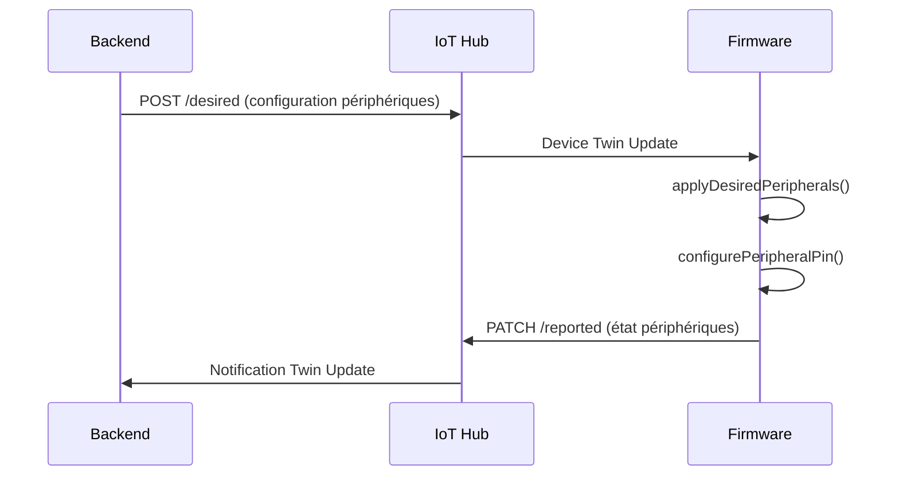
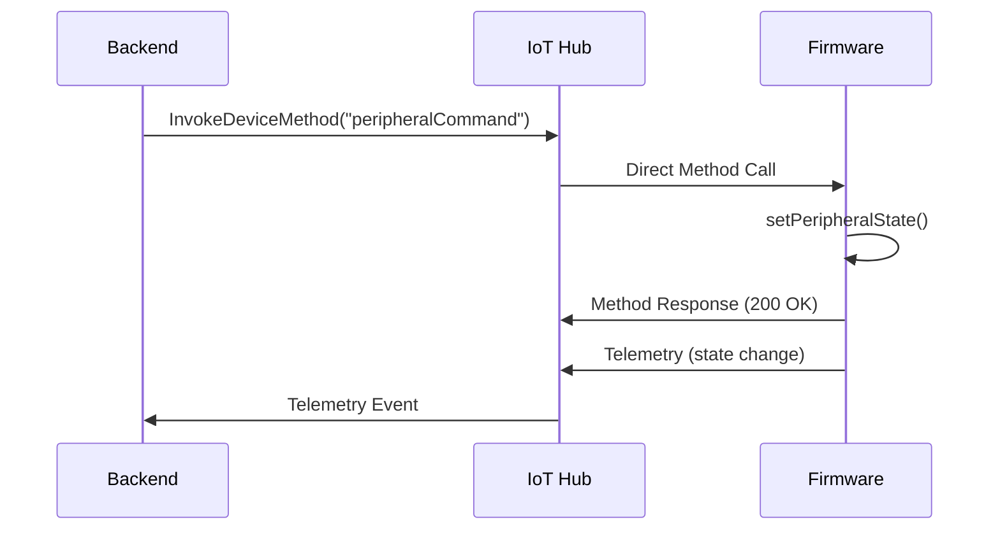
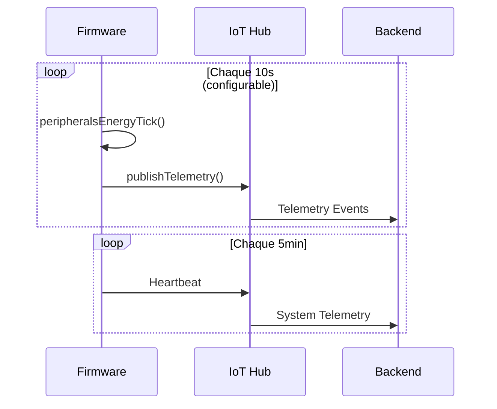

# ?? Guide de Compatibilité Firmware ESP32 v1.3.0 ?? Backend .NET

## ?? Vue d'ensemble

Ce document décrit la compatibilité entre le **firmware ESP32 v1.3.0** et le **backend ASP.NET Core**, en détaillant les structures de données, les endpoints API et les meilleures pratiques.

---

## ??? Architecture de Communication

```
???????????????????         MQTT/IoT Hub         ????????????????????
?  Firmware ESP32 ? ??????????????????????????   ?  Azure IoT Hub   ?
?    v1.3.0       ?   Device Twin / Methods      ?                  ?
???????????????????                               ????????????????????
                                                           ?
                                                           ? REST API
                                                           ?
                                                   ????????????????????
                                                   ?  Backend .NET 9  ?
                                                   ?  DeviceController?
                                                   ????????????????????
```

---

## ?? Structure de Données `PeripheralDto`

### ? Champs Supportés par le Firmware v1.3.0

```csharp
public class PeripheralDto
{
    // ===== CHAMPS DE BASE =====
    public string? Id { get; set; }                 // GUID unique (généré par firmware)
    public string Name { get; set; }                // Nom du périphérique (ex: "relay4")
    public string Type { get; set; }                // Type: "relay", "light", "sensor", etc.
    public int Gpio { get; set; }                   // Numéro GPIO (12-33)

    // ===== MÉTADONNÉES ADMINISTRATIVES (Backend) =====
    public string? Notes { get; set; }              // Notes de câblage
    public string? Unit { get; set; }               // Unité de mesure ("°C", "%", "W")
    public string? WiringDiagram { get; set; }      // URL du schéma de câblage
    public DateTime? InstalledAt { get; set; }      // Date d'installation

    // ===== ÉTAT TEMPS RÉEL (Firmware ? Backend) =====
    public object? State { get; set; }              // État actuel (true/false, valeur)
    public DateTime? LastUpdate { get; set; }       // Horodatage du dernier rapport
    public string? LastChange { get; set; }         // ISO8601 du dernier changement
    public string? Status { get; set; }             // "active", "error", "offline"
    public bool? Configured { get; set; }           // true si configuré avec succès
    public string? Error { get; set; }              // Message d'erreur si problème

    // ===== METERING (Consommation Énergétique) =====
    public string? Metering { get; set; }           // "none", "estimated", "measured"
    public float? RatedWatt { get; set; }           // Puissance nominale (W)
    public double? EnergyMWh { get; set; }          // Énergie consommée (mWh)
    public float? LastPowerMW { get; set; }         // Dernière puissance (mW)

    // ===== CONFIGURATION HARDWARE =====
    public bool? IsOutput { get; set; }             // true = sortie, false = entrée
    public bool? ActiveHigh { get; set; }           // true = actif haut, false = actif bas
}
```

---

## ?? Endpoints API Disponibles

### 1?? **Gestion des Périphériques**

#### **GET** `/api/Devices/{iotDeviceId}/peripherals`
Récupère la liste des périphériques (priorité: `reported` > `desired`).

**Réponse:**
```json
[
  {
    "id": "a8c9f8d2-...",
    "name": "relay4",
    "type": "relay",
    "gpio": 33,
    "state": true,
    "configured": true,
    "status": "active",
    "lastUpdate": "2025-01-20T10:30:00Z",
    "metering": "estimated",
    "ratedWatt": 100,
    "energyMWh": 5230.5,
    "lastPowerMW": 100000,
    "notes": "Contrôle éclairage principal",
    "unit": "W"
  }
]
```

---

#### **GET** `/api/Devices/{iotDeviceId}/peripherals/{name}`
Récupère un périphérique spécifique.

**Exemple:** `GET /api/Devices/mon-esp32/peripherals/relay4`

---

#### **POST** `/api/Devices/{iotDeviceId}/peripherals`
Ajoute un nouveau périphérique dans `desired.peripherals`.

**Body:**
```json
{
  "name": "relay5",
  "type": "relay",
  "gpio": 26,
  "notes": "Nouveau relais ajouté",
  "unit": "W",
  "metering": "estimated",
  "ratedWatt": 75,
  "isOutput": true,
  "activeHigh": true
}
```

---

#### **PUT** `/api/Devices/{iotDeviceId}/peripherals`
Remplace tous les périphériques (configuration complète).

**Body:**
```json
{
  "peripherals": [
    {
      "name": "relay4",
      "type": "relay",
      "gpio": 33,
      "metering": "estimated",
      "ratedWatt": 100
    }
  ]
}
```

---

#### **DELETE** `/api/Devices/{iotDeviceId}/peripherals/{name}`
Supprime un périphérique de `desired.peripherals`.

**Exemple:** `DELETE /api/Devices/mon-esp32/peripherals/relay4`

---

### 2?? **Gestion des Commandes**

#### **POST** `/api/Devices/{iotDeviceId}/peripherals/{name}/commands/{command}`
Envoie une commande à un périphérique spécifique.

**Commandes Supportées:**

| Type de Périphérique | Commandes Valides |
|----------------------|-------------------|
| `relay`, `light`, `actuator` | `on`, `off`, `toggle` |
| `sensor` | `read`, `reset` |
| `dimmer`, `led` | `on`, `off`, `toggle`, `setBrightness` |
| `rgb` | `on`, `off`, `setColor` |

**Exemples:**

**Allumer un relais:**
```bash
POST /api/Devices/mon-esp32/peripherals/relay4/commands/on
```

**Régler la luminosité:**
```bash
POST /api/Devices/mon-esp32/peripherals/led1/commands/setBrightness
{
  "parameters": {
    "level": 75
  }
}
```

---

### 3?? **Statistiques Énergétiques** ? **NOUVEAU**

#### **GET** `/api/Devices/{iotDeviceId}/peripherals/energy`
Récupère les statistiques énergétiques de tous les périphériques.

**Réponse:**
```json
{
  "deviceId": "mon-esp32",
  "timestamp": "2025-01-20T10:45:00Z",
  "peripherals": [
    {
      "name": "relay4",
      "type": "relay",
      "metering": "estimated",
      "ratedWatt": 100,
      "energyWh": 5.23,
      "currentPowerW": 100,
      "state": "on",
      "lastUpdate": "2025-01-20T10:30:00Z"
    }
  ],
  "totalEnergyWh": 12.45,
  "totalPowerW": 250
}
```

---

#### **POST** `/api/Devices/{iotDeviceId}/peripherals/energy/reset`
Réinitialise tous les compteurs énergétiques du device.

**Réponse:**
```json
{
  "message": "Compteurs énergétiques réinitialisés avec succès."
}
```

---

### 4?? **Device Twin Complet**

#### **GET** `/api/Devices/{iotDeviceId}/twin/full`
Récupère le Device Twin complet avec métadonnées.

**Réponse:**
```json
{
  "deviceId": "mon-esp32",
  "status": "enabled",
  "connectionState": "Connected",
  "lastActivityTime": "2025-01-20T10:30:00Z",
  "version": 1234,
  "desiredPeripherals": [...],
  "reportedPeripherals": [...],
  "rawDesiredProperties": "{...}",
  "rawReportedProperties": "{...}"
}
```

---

## ?? Flux de Synchronisation

### 1?? **Configuration Initiale (Backend ? Firmware)**



---

### 2?? **Commande Temps Réel (Backend ? Firmware)**



---

### 3?? **Reporting Énergétique (Firmware ? Backend)**



---

## ?? Meilleures Pratiques

### ? **À FAIRE**

1. **Toujours vérifier `configured: true`** avant d'envoyer des commandes
2. **Utiliser les endpoints `/merged`** pour voir la différence desired/reported
3. **Logger les erreurs** renvoyées par le firmware dans `error`
4. **Réinitialiser les compteurs énergétiques** après maintenance
5. **Utiliser les `notes` et `unit`** pour documenter les périphériques

### ? **À ÉVITER**

1. ? Envoyer des commandes invalides pour le type de périphérique
2. ? Modifier directement `reported` (read-only, géré par firmware)
3. ? Ignorer les champs `status` et `configured`
4. ? Oublier de valider les GPIO (12-33, éviter réservés)
5. ? Envoyer trop de commandes rapidement (risque de surcharge)

---

## ??? Débogage

### **Vérifier la synchronisation:**
```bash
GET /api/Devices/mon-esp32/peripherals/relay4/merged
```

**Réponse:**
```json
{
  "name": "relay4",
  "desiredConfig": { "name": "relay4", "gpio": 33, ... },
  "reportedState": { "name": "relay4", "gpio": 33, "state": true, ... },
  "isSynchronized": true
}
```

---

### **Consulter les logs firmware:**
Les logs sont envoyés automatiquement via télémétrie avec structure:
```json
{
  "level": "info",
  "source": "peripheral",
  "message": "État changé à ON",
  "peripheral": "relay4",
  "ts": "2025-01-20T10:30:00Z"
}
```

---

## ?? Sécurité

- **Authentification:** Tous les endpoints nécessitent `[Authorize(Roles = "Admin")]`
- **Validation GPIO:** Le firmware valide automatiquement les GPIO
- **Rate Limiting:** Limiter les appels à 10 req/s par device
- **Audit:** Tous les changements sont loggés dans `DeviceLogs`

---

## ?? Ressources Complémentaires

- [Azure IoT Hub Documentation](https://docs.microsoft.com/azure/iot-hub/)
- [ESP32 GPIO Guide](https://randomnerdtutorials.com/esp32-pinout-reference-gpios/)
- [Device Twin Documentation](https://docs.microsoft.com/azure/iot-hub/iot-hub-devguide-device-twins)

---

## ? Checklist Compatibilité

- ? Firmware v1.3.0 déployé sur ESP32
- ? Backend .NET 9 à jour
- ? IoT Hub configuré avec connexion
- ? Device Twin synchronisé
- ? Télémétrie active (interval: 10s)
- ? Logs structurés activés
- ? Métriques énergétiques fonctionnelles
- ? Commandes validées par type

---

**Version:** 1.0.0  
**Dernière mise à jour:** 20 Janvier 2025  
**Auteurs:** Équipe Smart Office
